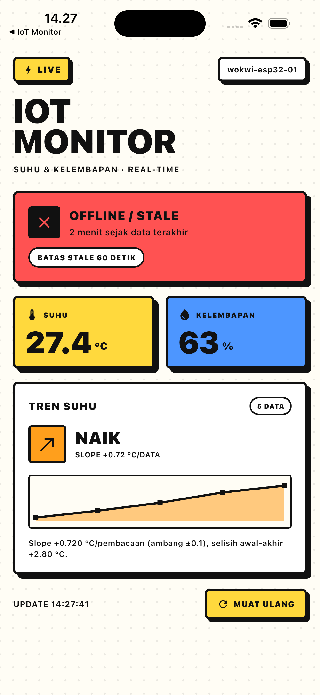
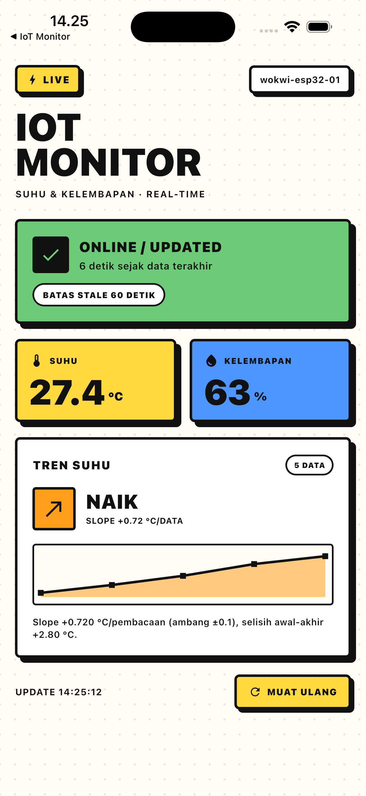

KEMENTERIAN AGAMA REPUBLIK INDONESIA

UNIVERSITAS ISLAM NEGERI PROFESOR KIAI HAJI SAIFUDDIN ZUHRI PURWOKERTO

FAKULTAS SAINS DAN TEKNOLOGI — PROGRAM STUDI INFORMATIKA

Jl. MT. Haryono, Karangsentul, Padamara, Purbalingga 53372 | saintek.uinsaizu.ac.id

---

LAPORAN UJIAN TENGAH SEMESTER (UTS)

IoT Reliability & Intelligent Monitoring Challenge: ESP32 + DHT22 + FastAPI + Flutter

Nama Mahasiswa : Arifian Ilham Nur Riandana  
NIM : 244110601111  
Program Studi / Semester : S1 Informatika / Semester 5 (Kelas C)  
Mata Kuliah : Komputasi Mobile dan IoT  
Hari / Tanggal : Kamis, 29 Oktober 2026  
Pertemuan / SKS : Pertemuan ke-8 / 3 SKS  
Dosen Penguji : M. Rifqi Atsani, M.Kom.  
Perangkat / Target : ESP32 (Wokwi) & iOS Simulator  
Tautan GitHub : https://github.com/arifianilhamnrr/UTS-IoT.git

## 1. Latar Belakang dan Arsitektur Sistem

Pada Ujian Tengah Semester ini, sistem monitoring suhu dan kelembapan yang telah
dibangun sebelumnya dikembangkan agar lebih andal, mampu menjaga kualitas data,
mencegah duplikasi, dan menghasilkan informasi tren yang bermakna. Sistem terdiri
atas empat komponen yang saling terhubung:

1. **Perangkat ESP32 + DHT22** yang disimulasikan di Wokwi, membaca suhu dan
   kelembapan setiap 5 detik.
2. **Firmware C++** dengan `reading_id` stabil, retry terbatas (3 percobaan,
   backoff 1 s dan 2 s), serta pengiriman ke Blynk dan backend FastAPI.
3. **Backend FastAPI** yang memvalidasi data, mencegah duplikasi dengan
   `UNIQUE(reading_id)`, menghitung status perangkat, dan menganalisis tren suhu.
4. **Aplikasi Flutter (iOS)** bergaya neobrutalism yang menampilkan status
   online/offline, suhu, kelembapan, dan tren beserta sparkline.

### 1.1 Endpoint Backend

| Endpoint | Method | Fungsi dan Peran |
| --- | --- | --- |
| `/api/readings` | POST | Menerima telemetri; validasi suhu 20–30 °C dan kelembapan 0–100 % (HTTP 422 bila melanggar) serta deduplikasi `reading_id` |
| `/api/readings` | GET | Mengambil histori data valid per perangkat |
| `/api/rejected` | GET | Menampilkan log payload yang ditolak beserta alasannya |
| `/api/devices/{id}/status` | GET | Menghitung status Online/Updated (≤ 60 s) atau Offline/Stale (> 60 s) dari `received_at` |
| `/api/devices/{id}/trend` | GET | Mengolah 5 pembacaan terakhir menjadi tren Naik, Turun, atau Stabil |
| `/api/devices/{id}/dashboard` | GET | Menggabungkan status, data terakhir, dan tren untuk aplikasi Flutter |

### 1.2 Kanal Blynk

Selain backend FastAPI, perangkat mengirim nilai yang sama ke Blynk
(template `LED IOT 1` dari project praktikum sebelumnya) melalui `V0` (suhu),
`V1` (kelembapan), dan `V2` (status koneksi). Kredensial disimpan di
`firmware/uts_iot/secrets.h` yang tidak di-commit; nilai token tidak ditampilkan
di laporan ini. Koneksi Blynk dibuat non-blocking (`Blynk.config` dan
`Blynk.connect`) agar gangguan pada layanan cloud tidak menghentikan pengiriman
data ke backend.

### 1.3 Tampilan Dashboard

Dashboard Flutter memakai gaya **neobrutalism**: border hitam 3 px, hard shadow
tanpa blur, blok warna jenuh (kuning, biru, hijau, merah), tipografi tebal, dan
efek tekan mekanis. Status tidak dibedakan hanya oleh warna, tetapi selalu
disertai ikon dan label teks. Token desain berada di
`mobile/lib/theme/brutal.dart` dan `design-system/iot-monitor/MASTER.md`.

## 2. Implementasi dan Bukti Pengujian Empat Tantangan Wajib

### 2.1 Challenge 1 — Offline Detection & Recovery (20 Poin)

**A. Aturan dan Desain.** Data dianggap stale/offline bila tidak ada data baru
selama 60 detik. Status dihitung di backend dari selisih waktu sekarang dengan
`received_at`, yaitu waktu server benar-benar menerima data, bukan dari status
aplikasi dibuka. Jika selisih ≤ 60 detik, status menjadi **Online/Updated**;
jika > 60 detik, status berubah menjadi **Offline/Stale**. Status kembali normal
secara otomatis begitu data baru diterima. Flutter memanggil endpoint dashboard
setiap 5 detik dan menghitung ulang umur data setiap 1 detik.

**B. Bukti Pengujian Transisi Status.** Pengujian dilakukan dengan menghentikan
pengiriman data selama 65 detik, lalu mengirim data baru untuk pemulihan.
Log aktual (`report/evidence/offline_recovery.log`):

````text
[14:02:48] STATUS     sekarang: online (umur data 0.0s)
[14:02:48] STATUS     menunggu 65 detik tanpa data baru ...
[14:03:53] STATUS     setelah 65s: offline (umur data 65.1s)
[14:03:53] STATUS     kirim data baru untuk recovery ...
[14:03:53] STATUS     setelah recovery: online (umur data 0.0s)
````

| Kondisi | Hasil yang Diharapkan | Hasil Aktual |
| --- | --- | --- |
| Data baru diterima | Online/Updated | Online, umur data 0,0 s |
| Tidak ada data selama 65 s | Offline/Stale | Offline, umur data 65,1 s |
| Data baru setelah offline | Kembali online | Online, umur data 0,0 s |

Gambar 1 menunjukkan status offline setelah data berhenti lebih dari 60 detik,
sedangkan Gambar 2 menunjukkan tampilan saat data masih segar. Keduanya diambil
dari aplikasi yang berjalan di iOS Simulator.



*Gambar 1. Dashboard iOS saat data berhenti lebih dari 60 detik: status berubah menjadi Offline/Stale.*



*Gambar 2. Dashboard iOS saat data masih segar: status Online/Updated dan tren suhu Naik.*

### 2.2 Challenge 2 — Sensor Data Validation (20 Poin)

**A. Aturan dan Lokasi Validasi.** Validasi diterapkan pada lapisan Backend API,
tepatnya di `ReadingIn` (`backend/app/schemas.py`) yang dipanggil oleh endpoint
`POST /api/readings`. Aturan yang digunakan: suhu wajib berada pada rentang
20–30 °C dan kelembapan pada rentang 0–100 %. Payload yang melanggar ditolak
dengan HTTP 422, tidak masuk tabel `readings`, dan dicatat di tabel
`rejected_readings` agar dapat diaudit. Data valid terakhir tidak pernah
tergantikan oleh data tidak valid.

**B. Bukti Pengujian Payload.**

| Skenario | Payload | Status HTTP dan Respons |
| --- | --- | --- |
| Valid | suhu 26,4 °C; kelembapan 61 % | 201 Created, `status: created`, data tersimpan |
| Suhu ekstrem | suhu 35,0 °C | 422, `Suhu 35.0 °C di luar rentang wajar 20-30 °C` |
| Kelembapan anomali | kelembapan 120 % | 422, `Kelembapan 120.0% di luar rentang 0-100%` |

Log aktual (`report/evidence/simulation.log`):

````text
[14:02:35] VALID      HTTP 201 -> created
[14:02:35] INVALID    HTTP 422 -> {'status': 'rejected', 'message': 'Payload tidak valid, data tidak disimpan.',
                                   'errors': [{'field': 'temperature', 'message': 'Value error, Suhu 35.0 °C di luar rentang wajar 20-30 °C'}]}
[14:02:35] INVALID    HTTP 422 -> {'status': 'rejected', ... 'Kelembapan 120.0% di luar rentang 0-100%'}
````

**C. Verifikasi Integritas Data Terakhir.** Pengujian otomatis
`test_data_invalid_tidak_mengganti_data_valid_terakhir` membuktikan bahwa setelah
payload suhu 10 °C ditolak, status perangkat tetap menampilkan pembacaan valid
26,5 °C. Tabel `rejected_readings` bertambah, sedangkan tabel `readings` tidak.

### 2.3 Challenge 3 — Smart Retry & Duplicate Prevention (20 Poin)

**A. Smart Retry Terbatas.** Firmware menerapkan maksimal 3 percobaan dengan
backoff 1 s lalu 2 s (`sendReading()` pada `firmware/uts_iot/uts_iot.ino`).
Kegagalan permanen berupa HTTP 4xx (kecuali 429) tidak diulang karena payload
yang sama akan gagal lagi. Klien Flutter juga memakai retry terbatas untuk
gangguan jaringan atau respons 5xx.

**B. Deduplikasi Idempotent.** Setiap pembacaan memiliki `reading_id` yang dibuat
sekali dan dipakai ulang pada semua percobaan. Kolom `reading_id` diberi
`UNIQUE` constraint. Jika `reading_id` sudah ada, backend mengembalikan record
lama dengan HTTP 200 dan `duplicate: true`; jika dua request identik datang
bersamaan, `IntegrityError` ditangkap dan record lama dikembalikan sehingga
tidak pernah ada baris ganda.

**C. Bukti Pengujian.**

| Percobaan | `reading_id` | Respons API | Jumlah Record |
| --- | --- | --- | --- |
| Kirim pertama (setelah 2× gagal jaringan) | `...-retry` | 201 Created, `duplicate: false` | 1 |
| Kirim ulang (retry) | `...-retry` | 200 OK, `duplicate: true` | Tetap 1 |
| Payload tidak valid | `...-bad-temp` | 422 Unprocessable Content | 0 (tidak disimpan) |

Log aktual:

````text
[14:02:35] RETRY      percobaan 1 gagal: ConnectError
[14:02:36] RETRY      percobaan 2 gagal: ConnectError
[14:02:38] RETRY      percobaan 3 sukses -> HTTP 201 (duplicate=False)
[14:02:38] DEDUPE     kirim ulang payload yang sama (reading_id identik)
[14:02:38] DEDUPE     HTTP 200 duplicate=True
[14:02:38] DEDUPE     jumlah record dengan reading_id tsb = 1 (harus 1)
````

### 2.4 Challenge 4 — Temperature Trend Analysis (20 Poin)

**A. Aturan Klasifikasi.** Tren dihitung dari 5 pembacaan valid terakhir yang
diurutkan menurut waktu. Kemiringan (slope) dihitung dengan regresi linear
sederhana:

```
slope = Σ((x - x̄)(y - ȳ)) / Σ((x - x̄)²),  x = 0..n-1, y = suhu
```

Klasifikasi: slope > +0,1 °C per pembacaan = **Naik**; slope < −0,1 °C per
pembacaan = **Turun**; selain itu **Stabil**. Ambang 0,1 dipilih agar noise
kecil DHT22 tidak langsung dianggap tren. Jika data kurang dari 5, hasilnya
`insufficient_data`.

**B. Bukti Pengujian.** Data uji yang dapat dijelaskan:

| Data Uji | Hasil | Slope | Delta |
| --- | --- | --- | --- |
| 24,0; 24,6; 25,2; 25,9; 26,8 | Naik | +0,69 °C/data | +2,80 °C |
| 28,5; 27,9; 27,0; 26,2; 25,4 | Turun | −0,79 °C/data | −3,10 °C |
| 26,0; 26,1; 25,9; 26,0; 26,05 | Stabil | ±0,01 °C/data | +0,05 °C |
| 26,0; 26,2 (2 data) | Belum cukup | — | — |

Log aktual:

````text
[14:02:38] TREND  seed 5 data naik: 24.0 24.6 25.2 25.9 26.8
[14:02:38] TREND  -> trend='naik', slope=+0.69, delta=+2.80 °C
[14:02:38] TREND  seed 5 data turun: 28.5 27.9 27.0 26.2 25.4
[14:02:38] TREND  -> trend='turun', slope=-0.79, delta=-3.10 °C
````

Hasil tren ditampilkan pada dashboard Flutter dalam kartu **TREN SUHU** lengkap
dengan label Naik/Turun/Stabil, nilai slope, dan sparkline lima data terakhir
(Gambar 2).

## 3. Engineering Defense dan AI Accountability (10 Poin)

### 3.1 Keputusan Desain Penting

Validasi dan deduplikasi diletakkan di backend, bukan di perangkat. Alasannya,
firmware dapat diubah, di-flash ulang, atau disimulasikan, sehingga aturan
kualitas data tidak boleh bergantung pada kepatuhan perangkat. Dengan
`UNIQUE(reading_id)` di database, duplikasi tetap dicegah bahkan ketika dua
request identik tiba bersamaan, sesuatu yang tidak dapat dijamin oleh
pengecekan `SELECT` saja.

### 3.2 Bagian Kode Hasil AI yang Diperiksa dan Diubah

Saran awal AI adalah menghitung staleness dari `recorded_at` (timestamp
perangkat) dan melakukan retry pada semua jenis kegagalan. Keduanya diubah:
status memakai `received_at` dari server karena jam perangkat dapat meleset,
dan retry dihentikan untuk HTTP 4xx selain 429 karena payload tidak valid tidak
akan berhasil jika diulang tanpa perubahan. Selain itu, `as_utc()` ditambahkan
karena SQLite mengembalikan `datetime` tanpa timezone; tanpa konversi ini
perhitungan selisih waktu akan melempar `TypeError`.

### 3.3 Satu Kegagalan yang Diuji

Kegagalan yang diuji adalah injeksi payload suhu 35 °C dan kelembapan 120 %.
Hasil yang diharapkan: backend menolak dengan HTTP 422, tidak membuat record
baru, dan data valid terakhir tetap dipertahankan. Hasil yang benar-benar
terjadi: HTTP 422 dengan pesan per field, tabel `readings` tidak bertambah,
tabel `rejected_readings` bertambah, dan dashboard tetap menampilkan suhu valid
terakhir 26,5 °C.

## 4. Pengujian Integrasi dan Dokumentasi (10 Poin)

### 4.1 Skenario Pengujian

| No | Skenario | Jenis | Ekspektasi | Hasil |
| --- | --- | --- | --- | --- |
| 1 | Kirim data valid 26,4 °C / 61 % | Normal | 201, tersimpan | Lulus |
| 2 | Data berhenti 65 detik | Abnormal | Offline/Stale | Lulus |
| 3 | Data baru setelah offline | Normal (recovery) | Online/Updated | Lulus |
| 4 | Suhu 35 °C | Abnormal | 422, histori aman | Lulus |
| 5 | Kelembapan 120 % | Abnormal | 422, histori aman | Lulus |
| 6 | Retry 2× gagal lalu berhasil | Abnormal | 1 record | Lulus |
| 7 | Kirim ulang `reading_id` sama | Abnormal | `duplicate=true`, 1 record | Lulus |
| 8 | Tren 5 data naik | Normal | Naik | Lulus |
| 9 | Tren 5 data turun | Normal | Turun | Lulus |
| 10 | Tren 5 data stabil | Normal | Stabil | Lulus |
| 11 | Tren dengan 2 data | Batas | `insufficient_data` | Lulus |
| 12 | Perangkat tanpa data | Abnormal | Offline, `last_seen=null` | Lulus |

Pengujian otomatis backend: **12 passed** (`report/evidence/pytest.log`).
Pengujian widget Flutter: **4 passed**. Analisis statis `flutter analyze`:
tidak ada isu. Build firmware PlatformIO: **SUCCESS**
(`report/evidence/pio_build.log`).

### 4.2 Bukti yang Dikumpulkan

- Log simulasi empat fitur: `report/evidence/simulation.log`
- Log offline dan recovery: `report/evidence/offline_recovery.log`
- Hasil test otomatis: `report/evidence/pytest.log`
- Build firmware: `report/evidence/pio_build.log`
- Screenshot dashboard online: `report/evidence/ios_dashboard_online.png`
- Screenshot dashboard offline: `report/evidence/ios_dashboard_offline.png`
- Repositori: <https://github.com/arifianilhamnrr/UTS-IoT.git>

## 5. Keterbatasan Sistem

1. Database default SQLite; untuk produksi dapat diganti MySQL melalui
   `DATABASE_URL`. Unique constraint dan penanganan duplikasi tetap sama.
2. Deteksi offline mengandalkan waktu server; bila server mati, Flutter hanya
   menampilkan pesan error koneksi, bukan status perangkat.
3. Tren memakai 5 data terakhir tanpa mempertimbangkan jarak waktu antar
   pembacaan; bila pengiriman tidak teratur, slope dihitung per pembacaan, bukan
   per menit.
4. Retry perangkat berhenti setelah 3 percobaan; data yang gagal total belum
   disimpan dalam antrean lokal (offline queue).
5. Ambang validasi 20–30 °C bersifat simulasi ruangan; untuk aplikasi lain
   ambang perlu disesuaikan.
6. Blynk hanya menjadi kanal monitoring tambahan; fitur UTS tetap dihitung di
   backend sendiri.

## 6. Checklist Mahasiswa

- [x] Status Online/Stale dan pemulihannya dapat ditunjukkan.
- [x] Data valid dan tidak valid telah diuji.
- [x] Retry diuji dan tidak ada duplikasi pembacaan.
- [x] Tren dihitung dari minimal lima data dan ditampilkan di Flutter.
- [x] Keputusan desain dan kode berbantuan AI dapat dijelaskan.
- [x] Project, bukti uji, screenshot, dan ringkasan hasil telah dikumpulkan.

## Lampiran: Log Pengujian
Log berikut disalin apa adanya dari pengujian yang dijalankan pada project ini. Tidak ada kredensial yang ditampilkan.

### A. simulation.log — empat fitur

````text
[14:02:35] HEALTH     {'status': 'ok', 'server_time': '2026-10-29T07:02:35.757000+00:00'}
[14:02:35] VALID      kirim payload valid (26.4 C, 61%)
[14:02:35] VALID      HTTP 201 -> created
[14:02:35] INVALID    kirim suhu 35 C (di luar 20-30)
[14:02:35] INVALID    HTTP 422 -> {'status': 'rejected', 'message': 'Payload tidak valid, data tidak disimpan.', 'errors': [{'field': 'temperature', 'message': 'Value error, Suhu 35.0 °C di luar rentang wajar 20-30 °C'}]}
[14:02:35] INVALID    kirim kelembapan 120% (di luar 0-100)
[14:02:35] INVALID    HTTP 422 -> {'status': 'rejected', 'message': 'Payload tidak valid, data tidak disimpan.', 'errors': [{'field': 'humidity', 'message': 'Value error, Kelembapan 120.0% di luar rentang 0-100%'}]}
[14:02:35] RETRY      simulasi 2x gagal jaringan lalu berhasil, reading_id tetap
[14:02:35] RETRY      percobaan 1 gagal: ConnectError
[14:02:35] RETRY      tunggu 1s lalu kirim ulang reading_id yang sama
[14:02:36] RETRY      percobaan 2 gagal: ConnectError
[14:02:36] RETRY      tunggu 2s lalu kirim ulang reading_id yang sama
[14:02:38] RETRY      percobaan 3 sukses -> HTTP 201 (duplicate=False)
[14:02:38] DEDUPE     kirim ulang payload yang sama (reading_id identik)
[14:02:38] DEDUPE     HTTP 200 duplicate=True
[14:02:38] DEDUPE     jumlah record dengan reading_id tsb = 1 (harus 1)
[14:02:38] TREND      seed 5 data naik: 24.0 24.6 25.2 25.9 26.8
[14:02:38] TREND      -> {'device_id': 'wokwi-esp32-01', 'trend': 'naik', 'window': 5, 'slope_per_reading': 0.69, 'delta': 2.8, 'temperatures': [24.0, 24.6, 25.2, 25.9, 26.8], 'explanation': 'Slope +0.690 °C/pembacaan (ambang ±0.1), selisih awal-akhir +2.80 °C.'}
[14:02:38] TREND      seed 5 data turun: 28.5 27.9 27.0 26.2 25.4
[14:02:38] TREND      -> {'device_id': 'wokwi-esp32-01', 'trend': 'turun', 'window': 5, 'slope_per_reading': -0.79, 'delta': -3.1, 'temperatures': [28.5, 27.9, 27.0, 26.2, 25.4], 'explanation': 'Slope -0.790 °C/pembacaan (ambang ±0.1), selisih awal-akhir -3.10 °C.'}
[14:02:38] STATUS     sekarang: online (umur data 0.0s)
````

### B. offline_recovery.log — transisi online, offline, dan recovery

````text
[14:02:45] HEALTH     {'status': 'ok', 'server_time': '2026-10-29T07:02:45.441432+00:00'}
[14:02:45] VALID      kirim payload valid (26.4 C, 61%)
[14:02:45] VALID      HTTP 201 -> created
[14:02:45] INVALID    kirim suhu 35 C (di luar 20-30)
[14:02:45] INVALID    HTTP 422 -> {'status': 'rejected', 'message': 'Payload tidak valid, data tidak disimpan.', 'errors': [{'field': 'temperature', 'message': 'Value error, Suhu 35.0 °C di luar rentang wajar 20-30 °C'}]}
[14:02:45] INVALID    kirim kelembapan 120% (di luar 0-100)
[14:02:45] INVALID    HTTP 422 -> {'status': 'rejected', 'message': 'Payload tidak valid, data tidak disimpan.', 'errors': [{'field': 'humidity', 'message': 'Value error, Kelembapan 120.0% di luar rentang 0-100%'}]}
[14:02:45] RETRY      simulasi 2x gagal jaringan lalu berhasil, reading_id tetap
[14:02:45] RETRY      percobaan 1 gagal: ConnectError
[14:02:45] RETRY      tunggu 1s lalu kirim ulang reading_id yang sama
[14:02:46] RETRY      percobaan 2 gagal: ConnectError
[14:02:46] RETRY      tunggu 2s lalu kirim ulang reading_id yang sama
[14:02:48] RETRY      percobaan 3 sukses -> HTTP 201 (duplicate=False)
[14:02:48] DEDUPE     kirim ulang payload yang sama (reading_id identik)
[14:02:48] DEDUPE     HTTP 200 duplicate=True
[14:02:48] DEDUPE     jumlah record dengan reading_id tsb = 1 (harus 1)
[14:02:48] TREND      seed 5 data naik: 24.0 24.6 25.2 25.9 26.8
[14:02:48] TREND      -> {'device_id': 'wokwi-esp32-01', 'trend': 'naik', 'window': 5, 'slope_per_reading': 0.69, 'delta': 2.8, 'temperatures': [24.0, 24.6, 25.2, 25.9, 26.8], 'explanation': 'Slope +0.690 °C/pembacaan (ambang ±0.1), selisih awal-akhir +2.80 °C.'}
[14:02:48] TREND      seed 5 data turun: 28.5 27.9 27.0 26.2 25.4
[14:02:48] TREND      -> {'device_id': 'wokwi-esp32-01', 'trend': 'turun', 'window': 5, 'slope_per_reading': -0.79, 'delta': -3.1, 'temperatures': [28.5, 27.9, 27.0, 26.2, 25.4], 'explanation': 'Slope -0.790 °C/pembacaan (ambang ±0.1), selisih awal-akhir -3.10 °C.'}
[14:02:48] STATUS     sekarang: online (umur data 0.0s)
[14:02:48] STATUS     menunggu 65 detik tanpa data baru ...
[14:03:53] STATUS     setelah 65s: offline (umur data 65.1s)
[14:03:53] STATUS     kirim data baru untuk recovery ...
[14:03:53] STATUS     setelah recovery: online (umur data 0.0s)
````

### C. pytest.log — 12 test otomatis

````text
............                                                             [100%]
=============================== warnings summary ===============================
.venv/lib/python3.15/site-packages/fastapi/testclient.py:1
  /Users/ar/Project/Matkul-IOT/UTS/backend/.venv/lib/python3.15/site-packages/fastapi/testclient.py:1: StarletteDeprecationWarning: Using `httpx` with `starlette.testclient` is deprecated; install `httpx2` instead.
    from starlette.testclient import TestClient as TestClient  # noqa

-- Docs: https://docs.pytest.org/en/stable/how-to/capture-warnings.html
12 passed, 1 warning in 1.04s
````

### D. pio_build.log — verifikasi build firmware

````text
Processing esp32doit-devkit-v1 (platform: espressif32; board: esp32doit-devkit-v1; framework: arduino)
--------------------------------------------------------------------------------
Verbose mode can be enabled via `-v, --verbose` option
CONFIGURATION: https://docs.platformio.org/page/boards/espressif32/esp32doit-devkit-v1.html
PLATFORM: Espressif 32 (7.1.3) > DOIT ESP32 DEVKIT V1
HARDWARE: ESP32 240MHz, 320KB RAM, 4MB Flash
DEBUG: Current (cmsis-dap) External (cmsis-dap, esp-bridge, esp-prog, iot-bus-jtag, jlink, minimodule, olimex-arm-usb-ocd, olimex-arm-usb-ocd-h, olimex-arm-usb-tiny-h, olimex-jtag-tiny, tumpa)
PACKAGES: 
 - framework-arduinoespressif32 @ 4.20017.260907+sha.dcc1105b 
 - tool-esptoolpy @ 2.41100.260830 (4.11.0) 
 - toolchain-xtensa-esp32 @ 8.4.0+2021r2-patch5
Converting uts_iot.ino
LDF: Library Dependency Finder -> https://bit.ly/configure-pio-ldf
LDF Modes: Finder ~ chain, Compatibility ~ soft
Found 38 compatible libraries
Scanning dependencies...
Dependency Graph
|-- Blynk @ 1.4.0
|-- DHT sensor library @ 1.4.7
|-- Adafruit Unified Sensor @ 1.1.15
|-- ArduinoJson @ 6.21.6
|-- HTTPClient @ 2.0.0
|-- WiFi @ 2.0.0
Building in release mode
Compiling .pio/build/esp32doit-devkit-v1/src/uts_iot.ino.cpp.o
Building .pio/build/esp32doit-devkit-v1/bootloader.bin
Generating partitions .pio/build/esp32doit-devkit-v1/partitions.bin
Compiling .pio/build/esp32doit-devkit-v1/lib965/BlynkNcpDriver/BlynkRpcCRC8.c.o
Compiling .pio/build/esp32doit-devkit-v1/lib965/BlynkNcpDriver/BlynkRpcClientWeakImpl.c.o
Compiling .pio/build/esp32doit-devkit-v1/lib965/BlynkNcpDriver/BlynkRpcInfra.c.o
Compiling .pio/build/esp32doit-devkit-v1/lib965/BlynkNcpDriver/BlynkRpcInfraUart.c.o
Compiling .pio/build/esp32doit-devkit-v1/lib965/BlynkNcpDriver/BlynkRpcUartFraming.c.o
Compiling .pio/build/esp32doit-devkit-v1/lib965/BlynkNcpDriver/MessageBuffer.c.o
Compiling .pio/build/esp32doit-devkit-v1/lib965/BlynkNcpDriver/MessageWriter.c.o
esptool.py v4.11.0
Creating esp32 image...
Merged 1 ELF section
Successfully created esp32 image.
Compiling .pio/build/esp32doit-devkit-v1/lib6d3/WiFi/WiFi.cpp.o
Archiving .pio/build/esp32doit-devkit-v1/lib965/libBlynkNcpDriver.a
Compiling .pio/build/esp32doit-devkit-v1/lib6d3/WiFi/WiFiAP.cpp.o
Compiling .pio/build/esp32doit-devkit-v1/lib6d3/WiFi/WiFiClient.cpp.o
Indexing .pio/build/esp32doit-devkit-v1/lib965/libBlynkNcpDriver.a
Compiling .pio/build/esp32doit-devkit-v1/lib6d3/WiFi/WiFiGeneric.cpp.o
Compiling .pio/build/esp32doit-devkit-v1/lib6d3/WiFi/WiFiMulti.cpp.o
Compiling .pio/build/esp32doit-devkit-v1/lib6d3/WiFi/WiFiSTA.cpp.o
Compiling .pio/build/esp32doit-devkit-v1/lib6d3/WiFi/WiFiScan.cpp.o
Compiling .pio/build/esp32doit-devkit-v1/lib6d3/WiFi/WiFiServer.cpp.o
Compiling .pio/build/esp32doit-devkit-v1/lib6d3/WiFi/WiFiUdp.cpp.o
Compiling .pio/build/esp32doit-devkit-v1/libdbe/Blynk/utility/BlynkDebug.cpp.o
Compiling .pio/build/esp32doit-devkit-v1/libdbe/Blynk/utility/BlynkHandlers.cpp.o
Compiling .pio/build/esp32doit-devkit-v1/libdbe/Blynk/utility/BlynkHelpers.cpp.o
Compiling .pio/build/esp32doit-devkit-v1/libdbe/Blynk/utility/BlynkTimeUtils.cpp.o
Compiling .pio/build/esp32doit-devkit-v1/libdbe/Blynk/utility/BlynkTimer.cpp.o
Compiling .pio/build/esp32doit-devkit-v1/libdbe/Blynk/utility/utility.cpp.o
Compiling .pio/build/esp32doit-devkit-v1/libc5b/Adafruit Unified Sensor/Adafruit_Sensor.cpp.o
Compiling .pio/build/esp32doit-devkit-v1/lib62d/DHT sensor library/DHT.cpp.o
Compiling .pio/build/esp32doit-devkit-v1/lib62d/DHT sensor library/DHT_U.cpp.o
Compiling .pio/build/esp32doit-devkit-v1/lib21f/WiFiClientSecure/WiFiClientSecure.cpp.o
Archiving .pio/build/esp32doit-devkit-v1/libdbe/libBlynk.a
Archiving .pio/build/esp32doit-devkit-v1/libc5b/libAdafruit Unified Sensor.a
Compiling .pio/build/esp32doit-devkit-v1/lib21f/WiFiClientSecure/esp_crt_bundle.c.o
Indexing .pio/build/esp32doit-devkit-v1/libdbe/libBlynk.a
Indexing .pio/build/esp32doit-devkit-v1/libc5b/libAdafruit Unified Sensor.a
Compiling .pio/build/esp32doit-devkit-v1/lib21f/WiFiClientSecure/ssl_client.cpp.o
Compiling .pio/build/esp32doit-devkit-v1/lib3df/HTTPClient/HTTPClient.cpp.o
Archiving .pio/build/esp32doit-devkit-v1/lib6d3/libWiFi.a
Indexing .pio/build/esp32doit-devkit-v1/lib6d3/libWiFi.a
Compiling .pio/build/esp32doit-devkit-v1/FrameworkArduino/Esp.cpp.o
Archiving .pio/build/esp32doit-devkit-v1/lib62d/libDHT sensor library.a
Compiling .pio/build/esp32doit-devkit-v1/FrameworkArduino/FirmwareMSC.cpp.o
Compiling .pio/build/esp32doit-devkit-v1/FrameworkArduino/FunctionalInterrupt.cpp.o
Indexing .pio/build/esp32doit-devkit-v1/lib62d/libDHT sensor library.a
Compiling .pio/build/esp32doit-devkit-v1/FrameworkArduino/HWCDC.cpp.o
Compiling .pio/build/esp32doit-devkit-v1/FrameworkArduino/HardwareSerial.cpp.o
Compiling .pio/build/esp32doit-devkit-v1/FrameworkArduino/IPAddress.cpp.o
Compiling .pio/build/esp32doit-devkit-v1/FrameworkArduino/IPv6Address.cpp.o
Compiling .pio/build/esp32doit-devkit-v1/FrameworkArduino/MD5Builder.cpp.o
Compiling .pio/build/esp32doit-devkit-v1/FrameworkArduino/Print.cpp.o
Compiling .pio/build/esp32doit-devkit-v1/FrameworkArduino/Stream.cpp.o
Compiling .pio/build/esp32doit-devkit-v1/FrameworkArduino/StreamString.cpp.o
Compiling .pio/build/esp32doit-devkit-v1/FrameworkArduino/Tone.cpp.o
Compiling .pio/build/esp32doit-devkit-v1/FrameworkArduino/USB.cpp.o
Compiling .pio/build/esp32doit-devkit-v1/FrameworkArduino/USBCDC.cpp.o
Compiling .pio/build/esp32doit-devkit-v1/FrameworkArduino/USBMSC.cpp.o
Compiling .pio/build/esp32doit-devkit-v1/FrameworkArduino/WMath.cpp.o
Compiling .pio/build/esp32doit-devkit-v1/FrameworkArduino/WString.cpp.o
Compiling .pio/build/esp32doit-devkit-v1/FrameworkArduino/base64.cpp.o
Compiling .pio/build/esp32doit-devkit-v1/FrameworkArduino/cbuf.cpp.o
Compiling .pio/build/esp32doit-devkit-v1/FrameworkArduino/esp32-hal-adc.c.o
Archiving .pio/build/esp32doit-devkit-v1/lib21f/libWiFiClientSecure.a
Indexing .pio/build/esp32doit-devkit-v1/lib21f/libWiFiClientSecure.a
Compiling .pio/build/esp32doit-devkit-v1/FrameworkArduino/esp32-hal-bt.c.o
Compiling .pio/build/esp32doit-devkit-v1/FrameworkArduino/esp32-hal-cpu.c.o
Compiling .pio/build/esp32doit-devkit-v1/FrameworkArduino/esp32-hal-dac.c.o
Compiling .pio/build/esp32doit-devkit-v1/FrameworkArduino/esp32-hal-gpio.c.o
Compiling .pio/build/esp32doit-devkit-v1/FrameworkArduino/esp32-hal-i2c-slave.c.o
Compiling .pio/build/esp32doit-devkit-v1/FrameworkArduino/esp32-hal-i2c.c.o
Compiling .pio/build/esp32doit-devkit-v1/FrameworkArduino/esp32-hal-ledc.c.o
Compiling .pio/build/esp32doit-devkit-v1/FrameworkArduino/esp32-hal-matrix.c.o
Compiling .pio/build/esp32doit-devkit-v1/FrameworkArduino/esp32-hal-misc.c.o
Compiling .pio/build/esp32doit-devkit-v1/FrameworkArduino/esp32-hal-psram.c.o
Compiling .pio/build/esp32doit-devkit-v1/FrameworkArduino/esp32-hal-rgb-led.c.o
Compiling .pio/build/esp32doit-devkit-v1/FrameworkArduino/esp32-hal-rmt.c.o
Compiling .pio/build/esp32doit-devkit-v1/FrameworkArduino/esp32-hal-sigmadelta.c.o
Compiling .pio/build/esp32doit-devkit-v1/FrameworkArduino/esp32-hal-spi.c.o
Compiling .pio/build/esp32doit-devkit-v1/FrameworkArduino/esp32-hal-time.c.o
Compiling .pio/build/esp32doit-devkit-v1/FrameworkArduino/esp32-hal-timer.c.o
Compiling .pio/build/esp32doit-devkit-v1/FrameworkArduino/esp32-hal-tinyusb.c.o
Compiling .pio/build/esp32doit-devkit-v1/FrameworkArduino/esp32-hal-touch.c.o
Compiling .pio/build/esp32doit-devkit-v1/FrameworkArduino/esp32-hal-uart.c.o
Compiling .pio/build/esp32doit-devkit-v1/FrameworkArduino/firmware_msc_fat.c.o
Compiling .pio/build/esp32doit-devkit-v1/FrameworkArduino/libb64/cdecode.c.o
Compiling .pio/build/esp32doit-devkit-v1/FrameworkArduino/libb64/cencode.c.o
Compiling .pio/build/esp32doit-devkit-v1/FrameworkArduino/main.cpp.o
Compiling .pio/build/esp32doit-devkit-v1/FrameworkArduino/stdlib_noniso.c.o
Compiling .pio/build/esp32doit-devkit-v1/FrameworkArduino/wiring_pulse.c.o
Compiling .pio/build/esp32doit-devkit-v1/FrameworkArduino/wiring_shift.c.o
Archiving .pio/build/esp32doit-devkit-v1/lib3df/libHTTPClient.a
Indexing .pio/build/esp32doit-devkit-v1/lib3df/libHTTPClient.a
Archiving .pio/build/esp32doit-devkit-v1/libFrameworkArduino.a
Indexing .pio/build/esp32doit-devkit-v1/libFrameworkArduino.a
Linking .pio/build/esp32doit-devkit-v1/firmware.elf
Retrieving maximum program size .pio/build/esp32doit-devkit-v1/firmware.elf
Checking size .pio/build/esp32doit-devkit-v1/firmware.elf
Advanced Memory Usage is available via "PlatformIO Home > Project Inspect"
RAM:   [=         ]  14.4% (used 47260 bytes from 327680 bytes)
Flash: [===       ]  29.9% (used 941241 bytes from 3145728 bytes)
Building .pio/build/esp32doit-devkit-v1/firmware.bin
esptool.py v4.11.0
Creating esp32 image...
Merged 27 ELF sections
Successfully created esp32 image.
========================= [SUCCESS] Took 34.53 seconds =========================
````
